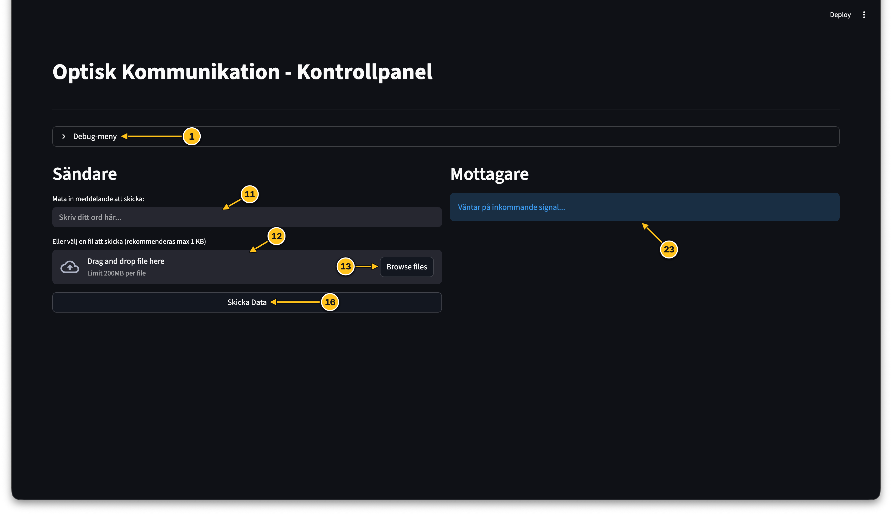
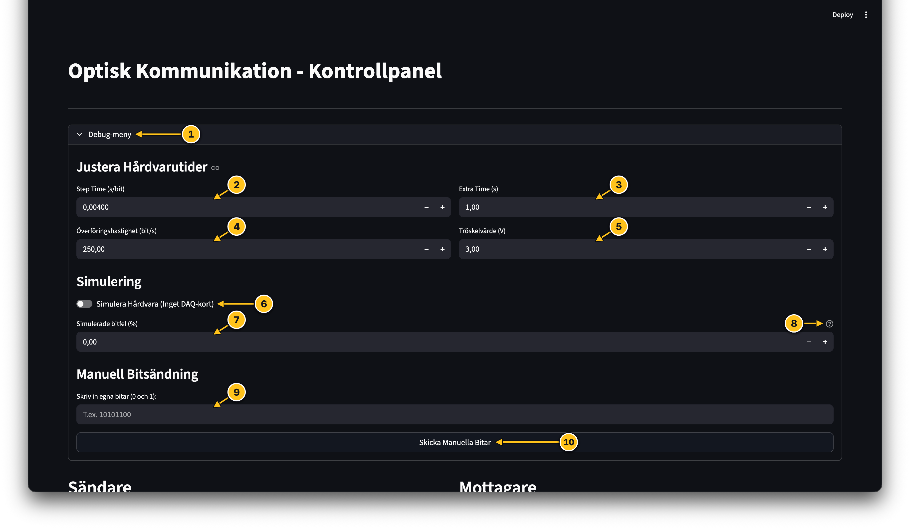
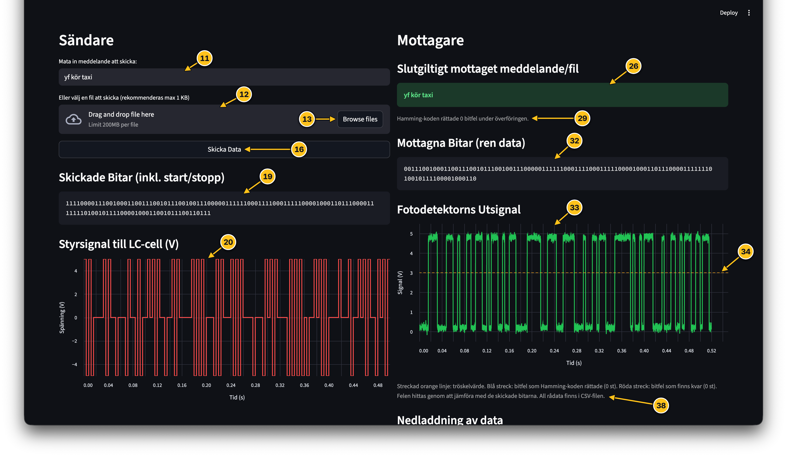
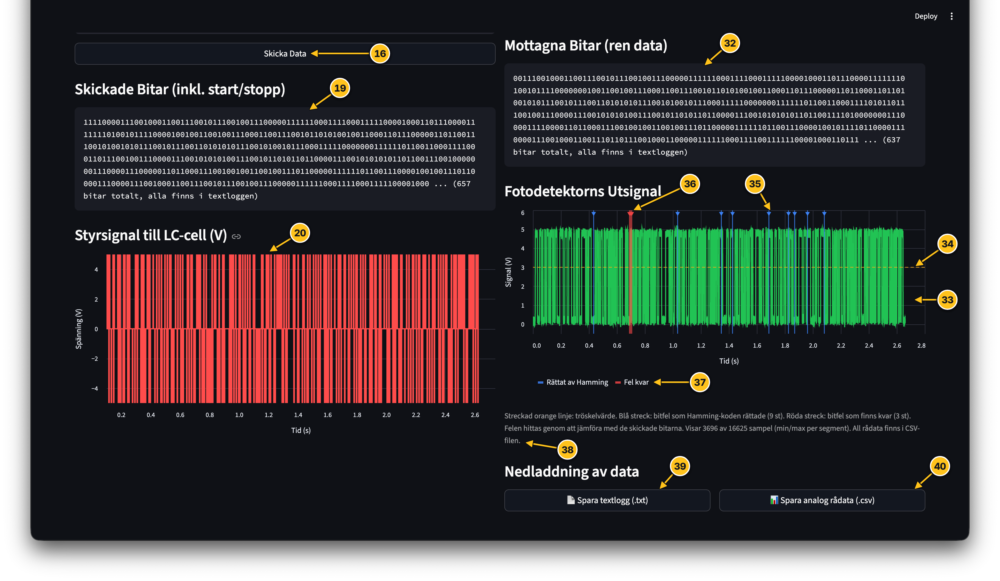
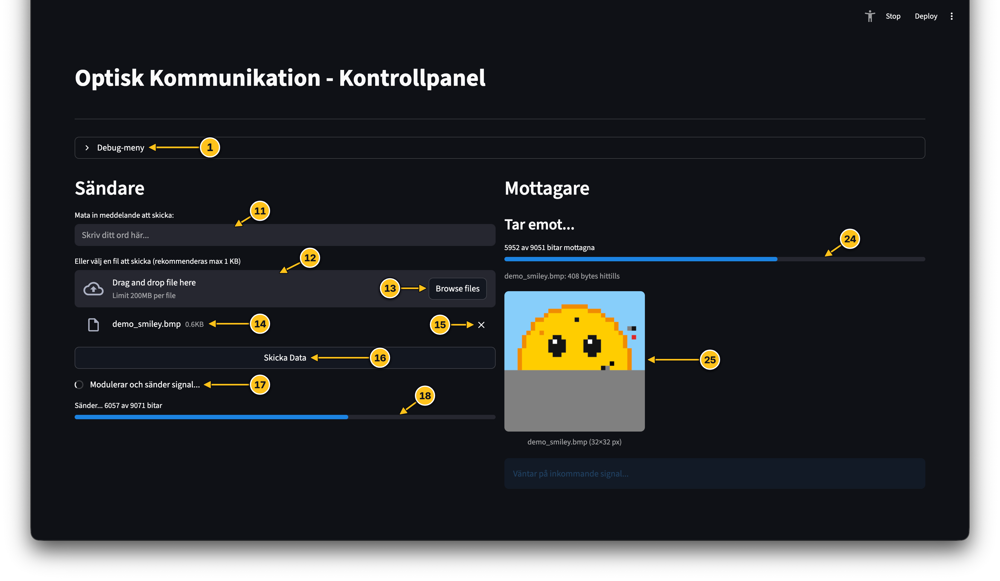
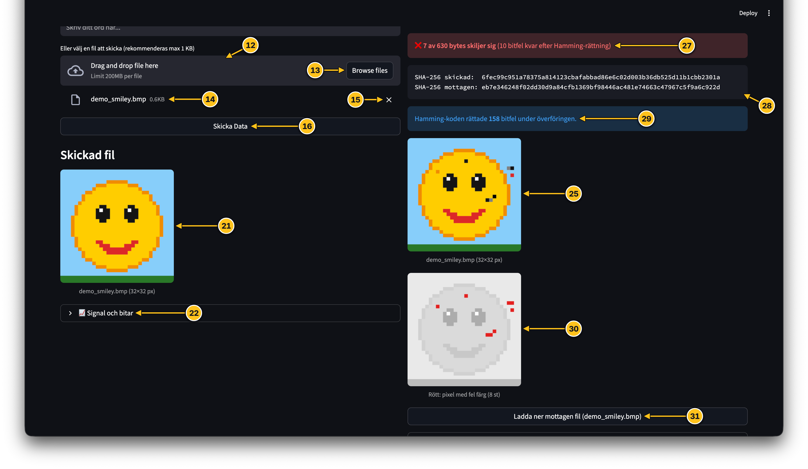

# Projekt_OPTKOM
Detta är koden för projektet optisk kommunikation i kursen TFYY51 Ingenjörsprojekt.

Syftet med koden är att generera styrsignaler till LC-cellen samt avkoda signalen med hjälp av fotodetektorn. Kommunikationen ska även genomföras på ett användarvänligt sätt.
## Installation
1. Installera python
  - Gå in på https://www.python.org/ och installera python
  
  >[!IMPORTANT]
  >Se till att klicka i "Add python to PATH" under installationen, annars kommer saker inte att funka!
  
2. Installera följande python-paket med hjälp av pip
  * streamlit
  * numpy
  * nidaqmx
  * matplotlib
  * watchdog (ej obligatorisk, ger bättre prestanda)

>[!NOTE]
>Du kan simulera funktionaliteten av användargränssnittet utan ```nidaqmx``` genom att klicka i "Simulera Hårdvara" under debug-menyn. Detta tillåter att programmet simuleras på datorer som till exempel inte kör windows. 
  
  Detta görs via körning av följande kommando: ```pip install [paket]```.
  
  >[!TIP]
  >Om det inte funkar med ```pip install [paket]``` så får du använda ```python3 -m pip install [paket]``` och ```[paket]``` byts självklart ut mot det faktiska paketet som du ska installera, t.ex. ```numpy```

## Användning av kommunikationssystemet

Programmet startas genom att köra:
```streamlit run /[path to folder]/optisk_kommunikation_app.py```

>[!TIP]
>Om detta inte funkar testa med ```python3 -m streamlit run /[path to folder]/optisk_kommunikation_app.py```

Programmets användargränssnitt öppnas automatiskt i din webbläsare.

### Introduktion användargränssnitt

<p align="center">
  
</p>

|Nummer|Beskrivning|
|---|---|
|<a id="n1"></a>1|Öppnar/stänger Debug-menyn där man kan ändra inställningar och komma åt avancerade funktioner|
|<a id="n11"></a>11|Fält där man skriver in meddelanden som man vill ska skickas|
|<a id="n12"></a>12|Fält för uppladdning av filer som ska skickas över den optiska länken|
|<a id="n13"></a>13|Knapp för att öppna upp utforskaren för att välja en fil att skicka över den optiska länken|
|<a id="n16"></a>16|Knapp för att skicka data som antingen matats in i form av fil (12) eller meddelande (11)|
|23|Meddelande som säger att ingen data har skickats och att mottagaren inväntar en startsekvens|

<p align="center">
  
</p>

|Nummer|Beskrivning|
|---|---|
|1|Öppnar/stänger Debug-menyn där man kan ändra inställningar och komma åt avancerade funktioner|
|<a id="n2"></a>2|Fält för att ändra tiden mellan två bitar och därmed överföringshastigheten i s/bit (ändrar fält 4)|
|<a id="n3"></a>3|Fält för att ändra hur mycket tid av "nollor" som läggs till i slutet av signalen|
|<a id="n4"></a>4|Fält för att ändra överföringshastigheten i bit/s (ändrar fält 2)|
|<a id="n5"></a>5|Fält för att ändra tröskelvärdet för vad som tolkas som en etta och nolla|
|<a id="n6"></a>6|Slider för att aktivera/avaktivera simuleringsläget som simulerar att skicka data med givna parametrar, med simuleringsläget på krävs ej biblioteket nidaqmx|
|<a id="n7"></a>7|Fält för att ändra mängden simulerade bitfel (funkar endast i simuleringsläget)|
|8|Hjälp-tips som förklarar hur simulerade bitfel funkar|
|<a id="n9"></a>9|Fält för att skriva in manuella bitsekvenser|
|<a id="n10"></a>10|Knapp för att skicka bitsekvensen som har skrivits in i fält 9|

<p align="center">
  
</p>

|Nummer|Beskrivning|
|---|---|
|11|Se [förklaring](#n11)|
|12|Se [förklaring](#n12)|
|13|Se [förklaring](#n13)|
|16|Se [förklaring](#n16)|
|<a id="n19"></a>19|Visar hela eller början (beroende på längd) på den skickade datan i bitar|
|<a id="n20"></a>20|Graf över den skickade signalen till LC-cell|
|<a id="n26"></a>26|Visar mottaget avkodat meddelande, 🟩 grönt om korrekt överföring, 🟥 rött om felaktig överföring|
|<a id="n29"></a>29|Visar antalet fel som Hamming-kodningen rättade samt antalet bitfel som den inte lyckades rätta|
|<a id="n32"></a>32|Visar hela eller början (beroende på längd) på den mottagna datan (exklusive start/stop) i bitar|
|<a id="n33"></a>33|Graf över fotodetektorns utsignal, för markeringar i graf se [röda markeringar (36)](#n36) och [blå markeringar (35)](#n35)|
|<a id="n34"></a>34|Linje som visar tröskelvärdet för mottagen signal (se [5](#n5))|
|<a id="n38"></a>38| Text som visar och förklarar [röda markeringar (36)](#n36) och [Blå markeringar (35)](#n35) samt överblivna [bitfel (29)](#n29)|

<p align="center">
  
</p>

|Nummer|Beskrivning|
|---|---|
|16|Se [förklaring](#n16)|
|19|Se [förklaring](#n19)|
|20|Se [förklaring](#n20)|
|32|Se [förklaring](#n32)|
|33|Se [förklaring](#n33)|
|34|Se [förklaring](#n34)|
|<a id="n35"></a>35|Blå markeringar i grafen som visar att Hamming-kodningen rättade ett fel där|
|<a id="n36"></a>36|Röda markeringar i grafen som visar att det finns ett fel kvar där|
|37|Förklaring till graf|
|38|Se [förklaring](#n38)|
|39|Knapp för att ladda ner en logg över senast skickade data i ```.txt``` format|
|40|Knapp för att ladda ner en ```.CSV``` fil som innehåller alla mätvärden från fotodetektorn samt skickad signal|

<p align="center">
  
</p>

|Nummer|Beskrivning|
|---|---|
|1|Se [förklaring](#n1)|
|11|Se [förklaring](#n11)|
|12|Se [förklaring](#n12)|
|13|Se [förklaring](#n13)|
|<a id="n14"></a>14|Visar namn och storlek på uppladdad fil|
|<a id="n15"></a>15|Knapp för att ta bort uppladdad fil|
|16|Se [förklaring](#n16)|
|17|Animerad ladd-symbol med text som visar att en signal skickas (antingen över laser eller i simuleringsläge)|
|<a id="n18"></a>18|Förloppsindikator som visar förloppet på datan som skickas|
|<a id="n24"></a>24|Förloppsindikator som visar förloppet på datan som mottas|
|<a id="n25"></a>25|Vid sändning av okomprimerade bildformat som ```.bmp``` filer så visas mottagandet av bilden i realtid|

<p align="center">
  
</p>

|Nummer|Beskrivning|
|---|---|
|12|Se [förklaring](#n12)|
|13|Se [förklaring](#n13)|
|14|Se [förklaring](#n14)|
|15|Se [förklaring](#n15)|
|16|Se [förklaring](#n16)|
|<a id="n21"></a>21|Visar bilden som skickats|
|22|Dropdown som visar graf och inledande bitar, såsom [19](#n19) och [20](#n20), samma sak finns för mottagarsidan|
|25|Se [förklaring](#n25)|
|<a id="n27"></a>27|Visar antalet bytes som skiljer sig från sändarsidan och antalet bitfel som har orsakat detta, om inget är fel så är rutan 🟩 grön, vid fel blir den 🟥 röd|
|<a id="n28"></a>28|Genererar SHA-256 hashes för både skickad fil och mottagen fil, om dessa stämmer överens så skedde överföringen förlustfritt|
|29|Se [förklaring](#n29)|
|<a id="n30"></a>30|Visar tydligt vilka pixlar vars data har blivit skadad under överföring i 🟥 rött samt visar även skadade paletter i 🟨 gult|
|31|Knapp för att ladda ned den mottagna filen, eventuella bitfel inkluderas även där|

### Procedurer
>[!CAUTION]
>#### Säkerhetsföreskrifter
>Följande säkerhetsföreskrifter är hämtade ordagrant ur IFM:s interna
>dokument "Laser" [^1]:
>
>1. Använd skyddsglasögon.
>2. Titta ej direkt in i laserstrålen.
>3. Titta ej i laserstråle reflekterad mot spekulär (blank) yta.
>4. Varna samtliga i rummet varje gång lasern tänds.
>5. Använd lasern endast när det krävs. 
>6. Den person som riktar/riktar om laserstrålen måste tillse att ingen annan person 
>riskerar att kunna få laserstrålen direkt mot ögonen eller reflekterad mot spekulär yta.
>7. Varje gång någon inför någonting (oavsett om det är reflekterande eller inte) i 
>laserstrålen måste samtliga i rummet varnas och ges tid att titta bort/skydda ögonen.

[^1]: Linköpings universitet, Institutionen för fysik, kemi och biologi (IFM),
"Laser," internt dokument, 2020-09-28, unpublished.


#### Skicka meddelande
För att skicka data i form av ett meddelande via [meddelande-rutan (11)](#n11) gör man på följande vis:

1. Kontrollera att du befinner dig i rätt sändningsläge (simulering eller skarp sändning), se [Simulera sändning av data](#simulera-sändning-av-data)
2. Skriv in ditt meddelande i [meddelande-rutan (11)](#n11)
3. Skicka meddelandet genom att trycka på ["Skicka Data"-knappen (16)](#n16)
4. Se det mottagna meddelandet under ["Slutgiltigt mottaget meddelande/fil" (26)](#n26), du kan även se de råa bitarna som mottagits under ["Mottagna bitar" (32)](#n32)
5. För nedladdning och vidare behandling av datan se [Inspektera styrsignal och mottagen signal i grafer](#inspektera-styrsignal-och-mottagen-signal-i-grafer) och [Ladda ned logg och data från sändning](#ladda-ned-logg-och-data-från-sändning)

#### Skicka fil
För att skicka en fil av valfritt format via [fil-uppladdnings-rutan (12)](#n12) gör man på följande vis:

1. Kontrollera att du befinner dig i rätt sändningsläge (simulering eller skarp sändning), se [Simulera sändning av data](#simulera-sändning-av-data)
2. Ladda upp filen som du vill skicka genom att trycka på [uppladdnings-knappen (13)](#n13) och välj filen i utforskaren
3. Skicka filen genom att trycka på ["Skicka Data"-knappen (16)](#n16)
4. Bevaka sändnings- och mottagningsprocessen genom att titta på förloppsindikatorerna [(18)](#n18) och [(24)](#n24), om det skickas okoromprimerade filer som användargränssnittet kan hantera, såsom ```.bmp``` eller ```.txt``` filer så återskapas dom i realtid på användargränssnittet [(25)](#n25).
5. När sändningen är klar kan du se om det har skett sändningsfel som ej kunde korrigeras genom att jämföra [SHA-256 hasharna (28)](#n28) och se antalet bitfel som kvarstår i rutan ovanför [(27)](#n27)
6. Mottagen fil kommer om möjligt [förhandsvisas (25)](#n25) och går att jämföra med [skickad fil (21)](#n21), vid sändning av t.ex. ```.bmp```-bilder så kommer även det finnas en bild som visar skillnader mellan skickad bild och mottagen bild [(30)](#n30)
7. För nedladdning och vidare behandling av datan se [Inspektera styrsignal och mottagen signal i grafer](#inspektera-styrsignal-och-mottagen-signal-i-grafer) och [Ladda ned logg och data från sändning](#ladda-ned-logg-och-data-från-sändning)

#### Simulera sändning av data
För att simulera sändning av data om man till exempel inte har hårdvaran närvarande eller inte kan installera biblioteket ```nidaqmx``` så gör man som följande:

1. Öppna [debug-menyn (1)](#n1)
2. Sätt igång simuleringsläget om det är av (standard är av vid start av användargränssnitt) genom att trycka på [simulerings-knappen (6)](#n6)

>[!NOTE]
>Simuleringsinställningen återställs inte mellan körningar men allt återställs vid omladdning av sidan.

För att stänga av simuleringsläget så stänger du bara av simulerings-knappen.

#### Ändra inställningar och parametrar för sändning
Inställningarna för programmet funkar som dom är från början men kan enkelt ändras via [debug-menyn (1)](#n1).

>[!WARNING]
>Inställningarna i debug-menyn har standardvärdena av en anledning och att ändra standardvärdena kan orsaka problem vid skarp sändning och även ibland vid simulerad sändning, så bara för att det funkar vid simulerad sändning betyder inte att det kommer funka vid skarp sändning.

- **För att ändra sändningshastigheten**, antingen i form av bitar per sekund eller sekunder per bit, ändrar du rutan [Step Time (2)](#n2) för att ändra i sekunder per bit och rutan [Överföringshastighet (4)](#n4) om du önskar att ändra den i bitar per sekund. 

- **För att ändra tiden med extra nollor på slutet av en sändning** så får man ändra [Extra Time (3)](#n3), en högre extra time kan i vissa fall förbättra tillförlitligheten vid sändningen.

- **För att ändra tröskelvärdet för fotodetektorns utsignal** så får man ändra [Tröskelvärdet (5)](#n5). När utsignalen blir högre än tröskelvärdet tolkas det som en etta, annars en nolla. Så beroende på sändningshastighet och egenskaperna på LC-cellen kan detta behövas justeras.

- **För att simulera bitfel i mottagen signal** kan man ändra värdet på [Simulerade bitfel (7)](#n7). Att lägga till simulerade bitfel är ett bra sätt att testa felkorrigering och tålighet mot fel men funkar endast för simulerad sändning och ett för högt värde kan lätt överväldiga felkorrigeringen och leda till att datan som sänds blir oläsbar.

#### Sändning av manuella bitsträngar
Sändning av manuella bitsträngar görs via [debug-menyn (1)](#n1).

1. Mata in bitsträngen i rutan under "Manuell Bitsändning" [(9)](#n9)
2. Tryck på knappen [Skicka Manuella Bitar (10)](#n10)
3. Bitsträngen skickas nu som en ett [vanligt meddelande](#skicka-meddelande) men avkodas inte då det är en bitsträng  
   
#### Inspektera styrsignal och mottagen signal i grafer
För att ta en närmare titt på styrsignalen och mottagen signal så finns det varsin graf för de olika signalerna. Vid sändning av filer är denna 
#### Ladda ned logg och data från sändning


