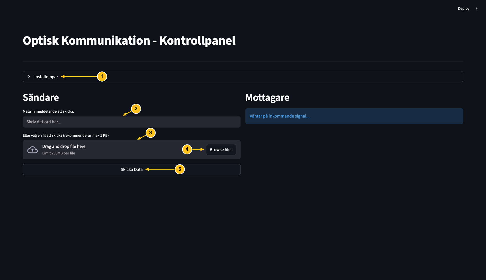
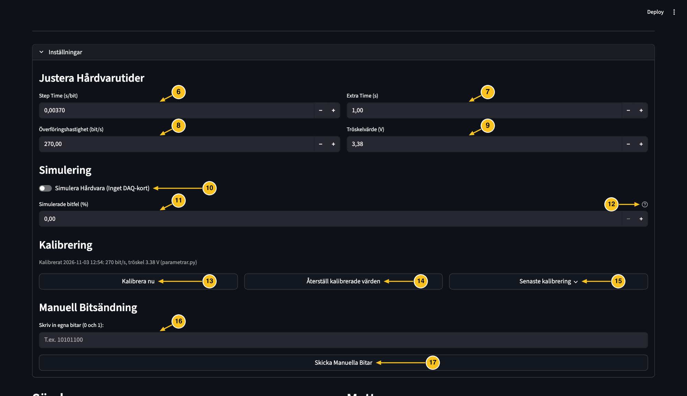
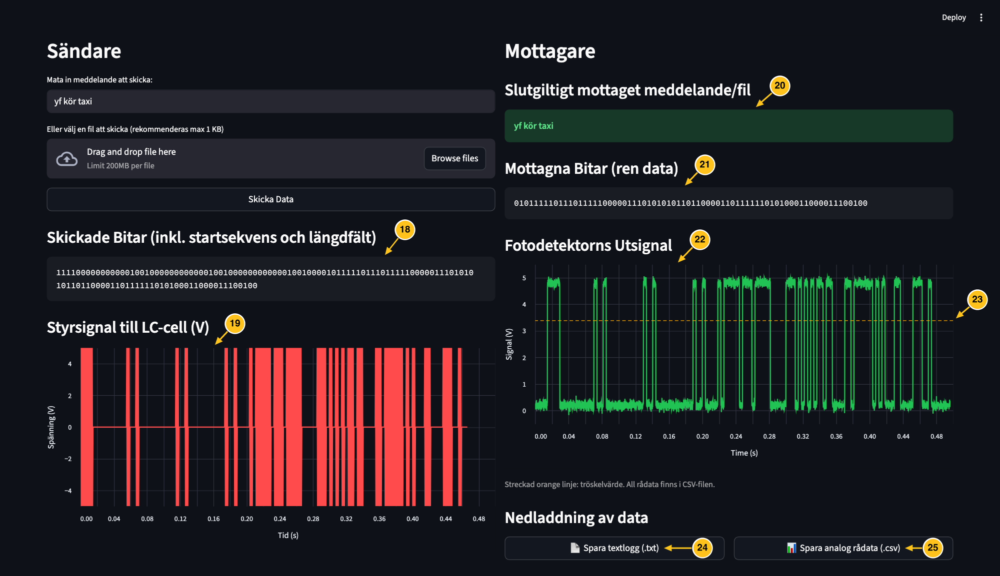
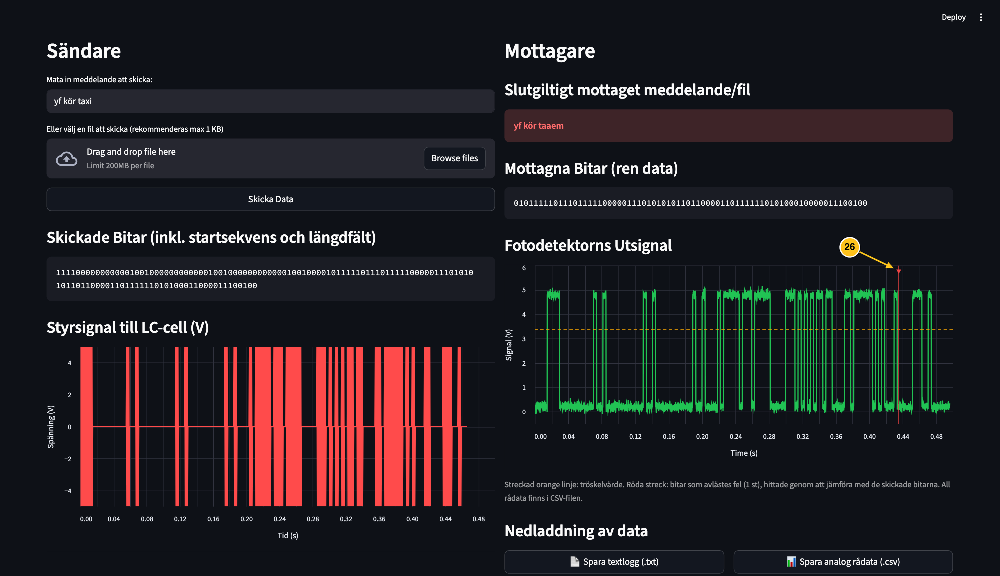
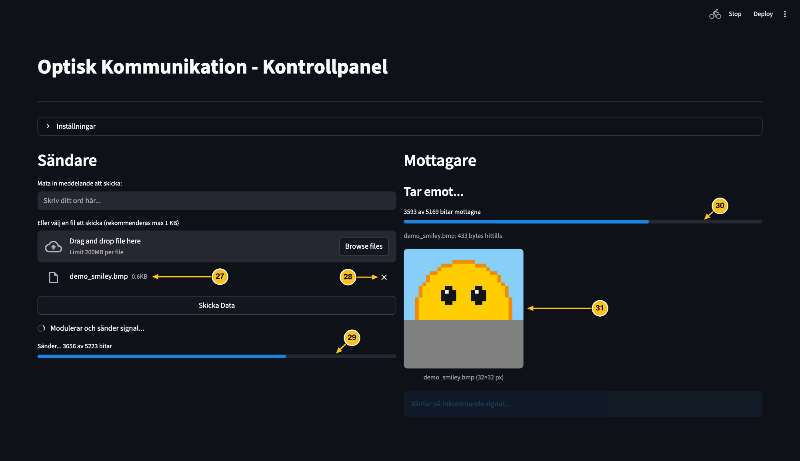
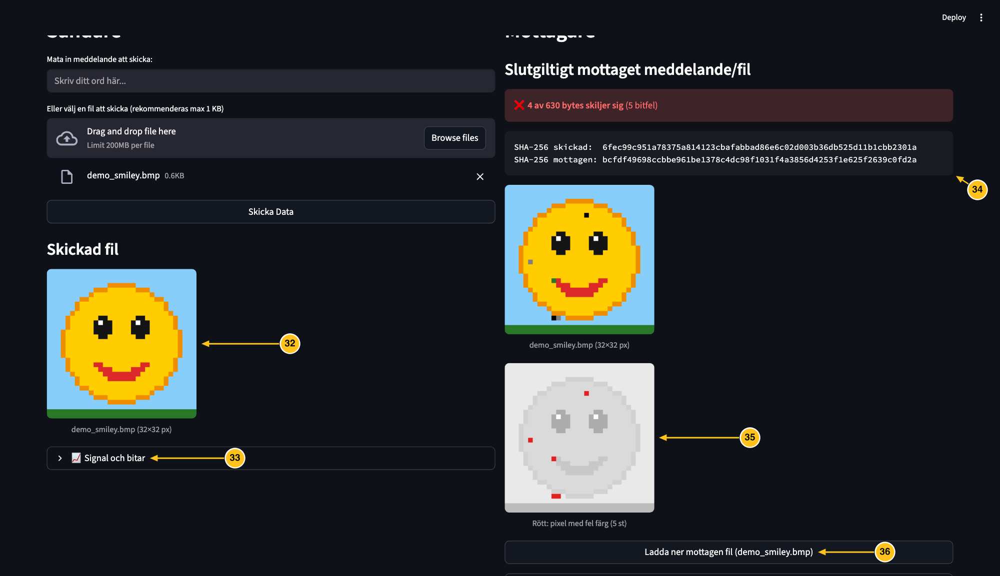

# Projekt_OPTKOM
Detta är koden för projektet optisk kommunikation i kursen TFYY51 Ingenjörsprojekt.

Syftet med koden är att generera styrsignaler till LC-cellen samt avkoda signalen med hjälp av fotodetektorn. Kommunikationen ska även genomföras på ett användarvänligt sätt.

## TODO
- [x] Göra klart guide för interface
- [x] Fixa kort guide för hårdvaran
- [x] Lägga till trädet för huffman-kodningen i loggen?
- [x] Lägga till kalibering i början av procedurer samt som egen procedur
- [x] Varför är .csv-filen på svenska?!
- [x] Warmup för Laser..... https://media.thorlabs.com/globalassets/items/p/pl/pl2/pl201/mtn016527-s01.pdf?v=0116021148

## Installation
1. Installera python
  - Gå in på https://www.python.org/ och installera python
  
  >[!IMPORTANT]
  >Se till att klicka i "Add python to PATH" under installationen, annars kommer saker inte att funka!
  
2. Installera följande python-paket med hjälp av pip
  * streamlit
  * numpy
  * pandas
  * altair
  * pillow
  * matplotlib
  * nidaqmx (behövs endast vid skarp sändning med DAQ-kortet)
  * watchdog (ej obligatorisk, ger bättre prestanda)

  >[!NOTE]
  >pandas, altair och pillow installeras normalt automatiskt tillsammans med streamlit, men de listas här eftersom programmet använder dem direkt.

>[!NOTE]
>Du kan simulera funktionaliteten av användargränssnittet utan ```nidaqmx``` genom att klicka i "Simulera Hårdvara" under inställningar. Detta tillåter att programmet simuleras på datorer som till exempel inte kör windows. 
  
  Detta görs via körning av följande kommando: ```pip install [paket]```.
  
  >[!TIP]
  >Om det inte funkar med ```pip install [paket]``` så får du använda ```python3 -m pip install [paket]``` och ```[paket]``` byts självklart ut mot det faktiska paketet som du ska installera, t.ex. ```numpy```

## Användning av kommunikationssystemet
Nedan följer information om hur man använder användargränssnittet, samt en kort guide för hårdvaran.

### Introduktion användargränssnitt
Här är en bild-sammanfattning för användargränssnittet, för en guide på hur man använder användargränssnittet, se [Procedurer](#procedurer).

#### Översikt av användargränssnittet
<p align="center">
  
</p>

|Nummer|Beskrivning|
|---|---|
|<a id="n1"></a>1|Öppnar/stänger inställningsmenyn där man kan ändra inställningar och komma åt avancerade funktioner|
|<a id="n15"></a>15|Fält där man skriver in meddelanden som man vill ska skickas|
|<a id="n16"></a>16|Fält för uppladdning av filer som ska skickas över den optiska länken|
|<a id="n17"></a>17|Knapp för att öppna upp utforskaren för att välja en fil att skicka över den optiska länken|
|<a id="n20"></a>20|Knapp för att skicka data som antingen matats in i form av fil [(16)](#n16) eller meddelande [(15)](#n15)|
|27|Meddelande som säger att ingen data har skickats och att mottagaren inväntar en startsekvens|

#### Inställningar
<p align="center">
  
</p>

|Nummer|Beskrivning|
|---|---|
|1|Öppnar/stänger inställningsmenyn där man kan ändra inställningar och komma åt avancerade funktioner|
|<a id="n2"></a>2|Fält för att ändra tiden mellan två bitar och därmed överföringshastigheten i s/bit (ändrar fält 4)|
|<a id="n3"></a>3|Fält för att ändra hur länge (i sekunder) styrsignalen hålls på 0 V, alltså “nollor”, efter att den sista biten har skickats. Det ger LC-cellen och mottagaren tid att läsa in den sista biten innan sändningen avslutas. Mottagaren använder längdfältet för att veta när meddelandet är slut, så ett högre värde gör bara sändningen längre. Påverkar endast skarp sändning|
|<a id="n4"></a>4|Fält för att ändra överföringshastigheten i bit/s (ändrar fält 2)|
|<a id="n5"></a>5|Fält för att ändra tröskelvärdet för vad som tolkas som en etta och nolla|
|<a id="n6"></a>6|Slider för att aktivera/avaktivera simuleringsläget som simulerar att skicka data med givna parametrar, med simuleringsläget på krävs ej biblioteket nidaqmx|
|<a id="n7"></a>7|Fält för att ändra mängden simulerade bitfel (funkar endast i simuleringsläget)|
|8|Hjälp-tips som förklarar hur simulerade bitfel funkar|
|<a id="n9"></a>9|Visar när systemet senast blev kalibrerat, vad den fick fram för värden och var datan från kalibreringen lagras|
|<a id="n10"></a>10|Knapp för att starta kalibrering av systemet|
|<a id="n11"></a>11|Knapp för att återställa inställningarna till de som kaliberingen rekomenderar|
|<a id="n12"></a>12|Dropdown-knapp som visar mer detaljerat resultat från senaste kalibrering|
|<a id="n13"></a>13|Fält för att skriva in manuella bitsekvenser|
|<a id="n14"></a>14|Knapp för att skicka bitsekvensen som har skrivits in i fält [(13)](#n13)|

#### Efter sändning av meddelande
<p align="center">
  
</p>

|Nummer|Beskrivning|
|---|---|
|15|Se [förklaring](#n15)|
|16|Se [förklaring](#n16)|
|17|Se [förklaring](#n17)|
|20|Se [förklaring](#n20)|
|<a id="n23"></a>23|Visar hela eller början (beroende på längd) på den skickade datan i bitar|
|<a id="n24"></a>24|Graf över den skickade signalen till LC-cell|
|<a id="n30"></a>30|Visar mottaget avkodat meddelande, 🟩 grönt om korrekt överföring, 🟥 rött om felaktig överföring|
|<a id="n35"></a>35|Visar hela eller början (beroende på längd) på den mottagna datan i bitar|
|<a id="n36"></a>36|Graf över fotodetektorns utsignal, för röda markeringar i graf se [(38)](#n38)|
|<a id="n37"></a>37|Linje som visar tröskelvärdet för mottagen signal (se [5](#n5))|
|<a id="n39"></a>39|Text som visar och förklarar [röda markeringar (38)](#n38) samt den sträckade orangea linjen|
|<a id="n40"></a>40|Knapp för att ladda ner en logg över senast skickade data i ```.txt``` format|
|<a id="n41"></a>41|Knapp för att ladda ner en ```.CSV``` fil som innehåller alla mätvärden från fotodetektorn samt skickad signal|

För guide på hur man skickar meddelanden, se |[Skicka meddelande](#skicka-meddelande).

#### Efter sändning av meddelande med fel
<p align="center">
  
</p>

|Nummer|Beskrivning|
|---|---|
|20|Se [förklaring](#n20)|
|23|Se [förklaring](#n23)|
|24|Se [förklaring](#n24)|
|30|Se [förklaring](#n30)|
|35|Se [förklaring](#n35)|
|36|Se [förklaring](#n36)|
|37|Se [förklaring](#n37)|
|<a id="n38"></a>38|Röd lodrät markering som visar var i sändningen som ett bitfel uppstod|
|39|Se [förklaring](#n39)|

För guide på hur man skickar meddelanden, se |[Skicka meddelande](#skicka-meddelande).

#### Efter sändning av fil
<p align="center">
  
</p>

|Nummer|Beskrivning|
|---|---|
|1|Se [förklaring](#n1)|
|15|Se [förklaring](#n15)|
|16|Se [förklaring](#n16)|
|17|Se [förklaring](#n17)|
|<a id="n18"></a>18|Visar namn och storlek på uppladdad fil|
|<a id="n19"></a>19|Knapp för att ta bort uppladdad fil|
|20|Se [förklaring](#n20)|
|21|Animerad ladd-symbol med text som visar att en signal skickas (antingen över laser eller i simuleringsläge)|
|<a id="n22"></a>22|Förloppsindikator som visar förloppet på datan som skickas|
|<a id="n28"></a>28|Förloppsindikator som visar förloppet på datan som mottas|
|<a id="n29"></a>29|Vid sändning av okomprimerade bildformat som ```.bmp``` filer så visas mottagandet av bilden i realtid|

För guide på hur man skickar filer, se |[Skicka fil](#skicka-fil).

##### Efter sändning av fil med fel
<p align="center">
  
</p>

|Nummer|Beskrivning|
|---|---|
|16|Se [förklaring](#n16)|
|17|Se [förklaring](#n17)|
|18|Se [förklaring](#n18)|
|19|Se [förklaring](#n19)|
|20|Se [förklaring](#n20)|
|<a id="n25"></a>25|Visar bilden som skickats|
|26|Dropdown som visar graf och inledande bitar, såsom [23](#n23) och [24](#n24), samma sak finns för mottagarsidan|
|29|Se [förklaring](#n29)|
|<a id="n31"></a>31|Visar antalet bytes som skiljer sig från sändarsidan och antalet bitfel som har orsakat detta, om inget är fel så är rutan 🟩 grön, vid fel blir den 🟥 röd|
|<a id="n32"></a>32|Genererar SHA-256 hashes för både skickad fil och mottagen fil, om dessa stämmer överens så skedde överföringen förlustfritt|
|<a id="n33"></a>33|Visar tydligt vilka pixlar vars data har blivit skadad under överföring i 🟥 rött samt visar även skadade paletter i 🟨 gult|
|34|Knapp för att ladda ned den mottagna filen, eventuella bitfel inkluderas även där|

För guide på hur man skickar filer, se |[Skicka fil](#skicka-fil).

### Procedurer
>[!CAUTION]
>#### Säkerhetsföreskrifter
>Följande säkerhetsföreskrifter är hämtade ordagrant ur IFM:s interna
>dokument "Laser" [^1]:
>
>1. Använd skyddsglasögon.
>2. Titta ej direkt in i laserstrålen.
>3. Titta ej i laserstråle reflekterad mot spekulär (blank) yta.
>4. Varna samtliga i rummet varje gång lasern tänds.
>5. Använd lasern endast när det krävs. 
>6. Den person som riktar/riktar om laserstrålen måste tillse att ingen annan person 
>riskerar att kunna få laserstrålen direkt mot ögonen eller reflekterad mot spekulär yta.
>7. Varje gång någon inför någonting (oavsett om det är reflekterande eller inte) i 
>laserstrålen måste samtliga i rummet varnas och ges tid att titta bort/skydda ögonen.

[^1]: Linköpings universitet, Institutionen för fysik, kemi och biologi (IFM),
"Laser," internal document, 2020-09-28, unpublished.

#### Uppstart av hårdvara
För att starta upp hårdvaran behövs följande göras:

1. Starta upp datorn som skall driva och kontrollera systemet
2. Koppla in USB-sladden från NI USB-6003 till datorn
3. Koppla in USB-sladden från Thorlabs PL201-lasern till datorn eller annan lämplig USB-strömkälla
4. Starta PL201-lasen genom att trycka knappen på sidan av laserns USB-A-kontakt

>[!WARNING]
>Lasern har en uppvärmningstid på 15 minuter[^2] och det rekommenderas därför inte att kalibrera eller använda systemet innan dess, då laserns egenskaper förändras något under uppvärmningen.

[^2]: Thorlabs, "PL201 Compact Laser Module with USB, 520 nm," Datablad
MTN016527-S01, Rev C, jan. 2024. [Online]. Available:
https://media.thorlabs.com/globalassets/items/p/pl/pl2/pl201/mtn016527-s01.pdf.
Accessed: 2026-11-05.

#### Uppstart av mjukvara
Programmet startas genom att köra:
```streamlit run /[path to folder]/optisk_kommunikation_app.py```

>[!TIP]
>Om detta inte funkar testa med ```python3 -m streamlit run /[path to folder]/optisk_kommunikation_app.py```

Programmets användargränssnitt öppnas automatiskt i din webbläsare.

#### Skicka meddelande
För att skicka data i form av ett meddelande via [meddelande-rutan (15)](#n15) gör man på följande vis:

1. Kontrollera att du befinner dig i rätt sändningsläge (simulering eller skarp sändning), se [Simulera sändning av data](#simulera-sändning-av-data)
2. [Kalibrera system](#kalibrering-av-systemet) om ej genomfört under aktuellt användningstillfälle
3. Skriv in ditt meddelande i [meddelande-rutan (15)](#n15)
4. Skicka meddelandet genom att trycka på ["Skicka Data"-knappen (20)](#n20)
5. Se det mottagna meddelandet under ["Slutgiltigt mottaget meddelande/fil" (30)](#n30), du kan även se de råa bitarna som mottagits under ["Mottagna bitar" (35)](#n35)
6. För nedladdning och vidare behandling av datan se [Inspektera styrsignal och mottagen signal i grafer](#inspektera-styrsignal-och-mottagen-signal-i-grafer) och [Ladda ned logg och data från sändning](#ladda-ned-logg-och-data-från-sändning)

#### Skicka fil
För att skicka en fil av valfritt format via [fil-uppladdnings-rutan (16)](#n16) gör man på följande vis:

1. Kontrollera att du befinner dig i rätt sändningsläge (simulering eller skarp sändning), se [Simulera sändning av data](#simulera-sändning-av-data)
2. [Kalibrera system](#kalibrering-av-systemet) om ej genomfört under aktuellt användningstillfälle
3. Ladda upp filen som du vill skicka genom att trycka på [uppladdnings-knappen (17)](#n17) och välj filen i utforskaren
4. Skicka filen genom att trycka på ["Skicka Data"-knappen (20)](#n20)
5. Bevaka sändnings- och mottagningsprocessen genom att titta på förloppsindikatorerna [(22)](#n22) och [(28)](#n28), om det skickas okoromprimerade filer som användargränssnittet kan hantera, såsom ```.bmp``` eller ```.txt``` filer så återskapas dom i realtid på användargränssnittet [(29)](#n29).
6. När sändningen är klar kan du se om det har skett sändningsfel genom att jämföra [SHA-256 hasharna (32)](#n32) och se antalet bitfel i rutan ovanför [(31)](#n31)
7. Mottagen fil kommer om möjligt [förhandsvisas (29)](#n29) och går att jämföra med [skickad fil (25)](#n25), vid sändning av t.ex. ```.bmp```-bilder så kommer även det finnas en bild som visar skillnader mellan skickad bild och mottagen bild [(33)](#n33)
8. För nedladdning och vidare behandling av datan se [Inspektera styrsignal och mottagen signal i grafer](#inspektera-styrsignal-och-mottagen-signal-i-grafer) och [Ladda ned logg och data från sändning](#ladda-ned-logg-och-data-från-sändning)

#### Simulera sändning av data
För att simulera sändning av data om man till exempel inte har hårdvaran närvarande eller inte kan installera biblioteket ```nidaqmx``` så gör man som följande:

1. Öppna [inställningsmenyn (1)](#n1)
2. Sätt igång simuleringsläget om det är av (standard är av vid start av användargränssnitt) genom att trycka på [simulerings-knappen (6)](#n6)

>[!NOTE]
>Simuleringsinställningen återställs inte mellan körningar men allt återställs vid omladdning av sidan.

För att stänga av simuleringsläget så stänger du bara av simulerings-knappen.

#### Ändra inställningar och parametrar för sändning
Kalibering och ändning av inställningar görs enkelt via [inställningsmenyn (1)](#n1).

>[!WARNING]
>Inställningarna i inställningsmenyn får ett visst värde från kalibreringen av en anledning att ändra standardvärdena kan orsaka problem vid skarp sändning och även ibland vid simulerad sändning, så bara för att det funkar vid simulerad sändning betyder inte att det kommer funka vid skarp sändning.

- **För att ändra sändningshastigheten**, antingen i form av bitar per sekund eller sekunder per bit, ändrar du rutan [Step Time (2)](#n2) för att ändra i sekunder per bit och rutan [Överföringshastighet (4)](#n4) om du önskar att ändra den i bitar per sekund. 

- **För att ändra tiden med extra nollor på slutet av en sändning** så får man ändra [Extra Time (3)](#n3), en högre extra time kan i vissa fall förbättra tillförlitligheten vid sändningen.

- **För att ändra tröskelvärdet för fotodetektorns utsignal** så får man ändra [Tröskelvärdet (5)](#n5). När utsignalen blir högre än tröskelvärdet tolkas det som en etta, annars en nolla. Så beroende på sändningshastighet och egenskaperna på LC-cellen kan detta behövas justeras.

- **För att simulera bitfel i mottagen signal** kan man ändra värdet på [Simulerade bitfel (7)](#n7). Att lägga till simulerade bitfel är ett bra sätt att se hur fel påverkar mottagen data men funkar endast för simulerad sändning och ett för högt värde (eller något värde över 0%, beroende på typ av data) kan lätt och leda till att datan som sänds blir oläsbar.

#### Kalibrering av systemet
För att kalibrera systemet för en viss upställning och omgivande variabler så kan kaliberingsinställningarna användas i [inställningsmenyn (1)](#n1).

Gör som följande:
1. Öppna [inställningsmenyn (1)](#n1)
2. Verifiera att du är i förväntat sändningsläge [(6)](#n6), alltså det sändningsläge som ska användas för kommande sändningar.
3. Tryck på ["Kalibera nu"-knappen (10)](#n10)
4. Vänta på att kaliberignen genomförs, det kan ta någon minut.
5. När kaliberingen är klar visas ett meddelande med de nya kalibererade värdena som automatiskt uppdaterar inställningar

Om man vill se mer detaljer kring en genomförd kaliberering så kan det ses genom att trycka på [senaste kalibering dropdownen (12)](#n12).

För att återställa inställningarna till det senaste kalibrerade värdet så trycker man på [återställ kaliberade värden (11)](#n11).

>[!WARNING]
>Lasern har en uppvärmningstid på 15 minuter[^2] och det rekommenderas därför inte att kalibrera eller använda systemet innan dess, då laserns egenskaper förändras något under uppvärmningen.

#### Sändning av manuella bitsträngar
Sändning av manuella bitsträngar görs via [inställningsmenyn (1)](#n1).

1. [Kalibrera system](#kalibrering-av-systemet) om ej genomfört under aktuellt användningstillfälle
2. Mata in bitsträngen i rutan under "Manuell Bitsändning" [(13)](#n13)
3. Tryck på knappen [Skicka Manuella Bitar (14)](#n14)
4. Bitsträngen skickas nu som en ett [vanligt meddelande](#skicka-meddelande) men avkodas inte då det är en bitsträng  
   
#### Inspektera styrsignal och mottagen signal i grafer
För att ta en närmare titt på styrsignalen och mottagen signal så finns det varsin graf för de olika signalerna. Vid sändning av filer är denna gömd bakom en dropdown för att datan ofta är för stor för att hantera i användargränssnittet, därav rekommenderas det att [ladda ned datan](#ladda-ned-logg-och-data-från-sändning) i detta fall. Då webbläsare får svårt att visa den stora mängd data som samlas in utan att bli oanvändbar på grund av lagg så **begränsas antalet datapunkter i grafer till ca 4000 st**. Även **visningen av ren data begränsas till de första bitarna** vid längre sändningar av samma anledning.

- För att **inspektera styrsignalsgrafen** om man har [skickat ett meddelande](#skicka-meddelande) så visas [grafen (24)](#n24) alltid rakt under sändarsidan, om man istället [skickat en fil](#skicka-fil) så är den gömd längs ned under en dropdown. Y-axeln är spänningen för styrsignalen och X-axeln är tiden i sekunder sedan början av sändning. Vid en amplitud på +-5v på styrsignalen så kommer 0v representera en nolla och både +5v och -5v representera en etta då de ger samma resultat på modulationen av lasern men minskar slitage på LC-cellen.

- För att **inspektera grafen över fotodetektorns utsignal** så, precis som vid sändningsgrafen efter sändning, så är [grafen (36)](#n36) gömd längst ned vid sändning av fil och dyker upp direkt under mottagarsidan vid sändning av meddelande. Y-axeln visar spänningen från fotodetektorn efter transimpedansförstärkaren och går normalt sätt någons stans mellan 0v och +5v. X-axeln visar, som i sändningsgrafen, tid i sekunder sedan början av sändning. Om den mottagna signalen i grönt är över [tröskelvärdet (37)](#n37), som visas sträckat i orange så tolkas det som en etta och om signalen är under tröskelvärdet så tolkas det som en nolla. Om det finns fel i mottagen data så markeras de med ett [rött lodrätt sträck (38)](#n38) i grafen.

>[!NOTE]
>Datan för att markera bitfel med röda lodräta sträck skickas över lasern men detta anses vara lämpligt då datan inte har något med resultatet av en överföring att göra utan endast används för att lättare demonstrera och visualisera systemet. Datan behövs alltså inte för att överföringen ska kunna ske!

- För att **inspektera skickade och mottagna bitar** så hittas de, precis som med graferna efter sändning, antingen under en dropdown vid sändning av filer och direkt på vardera sida vid sändning av meddelande. I rutorna ([(23)](#n23) och [(35)](#n35)) kan början av den skickade/mottagna bitsekvensen inspekteras.

#### Ladda ned logg och data från sändning
För att ladda ned logg och eller en CSV:n så gör man på följande vis:

1. Efter att data av något slag har skickats så finns två nedladdningsknappar längst ned på mottagarsidan, en för loggen och en för CSV-filen.
2. Klicka på motsvarande knapp för det som du önskar att ladda ned ([(40)](#n40) och [(41)](#n41))
3. Hantera nedladdad data på valfritt sätt, förslagsvis anteckningar för ```.txt``` loggen och Excel eller liknande för ```.csv``` filen

Filerna har följande innehåll:
||Logg (```.txt```)| Rådata (```.csv```)|
|----|----|----|
|Tid och datum|🟩|🟩| 
|Namn på skickad och mottagen data|🟩|🟥|
|Skickat meddelande och mottaget meddelande|🟩|🟥|
|Visar om datan är simulerad|🟩|🟥|
|Innehåller överföringshastigheten|🟩|🟥|
|Innehåller "Extra Time"|🟩|🟥|
|Innehåller tröskelvärde för signal|🟩|🟩|
|Innehåller alla skickade och mottagna bitar|🟩|🟥|
|Innehåller antalet bitfel som fanns i mottagen data|🟩|🟥|
|Innehåller storlek på skickad och mottagen fil|🟩|🟥|
|Innehåller antalet bytes som skadades under sändning|🟩|🟥|
|Innehåller skickad och mottagen SHA-256 hash|🟩|🟥|
|Visar om det uppstod fel under avkodning|🟩|🟥|
|Innehåller vilken kalibrering som användes|🟩|🟥|
|Innehåller Huffman-kodboken och det skickade meddelandet tecken för tecken så att mottagna bitar kan avkodas för hand (endast vid sändning av meddelande)|🟩|🟥|
|Innehåller alla datapunkter uppfångade av mottagarens ADC med tillhörande tid|🟥|🟩|


